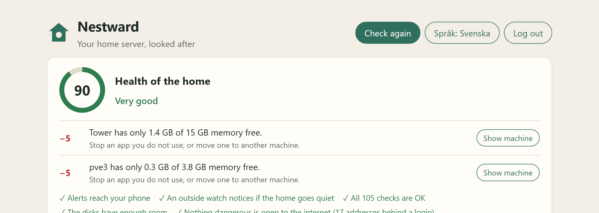
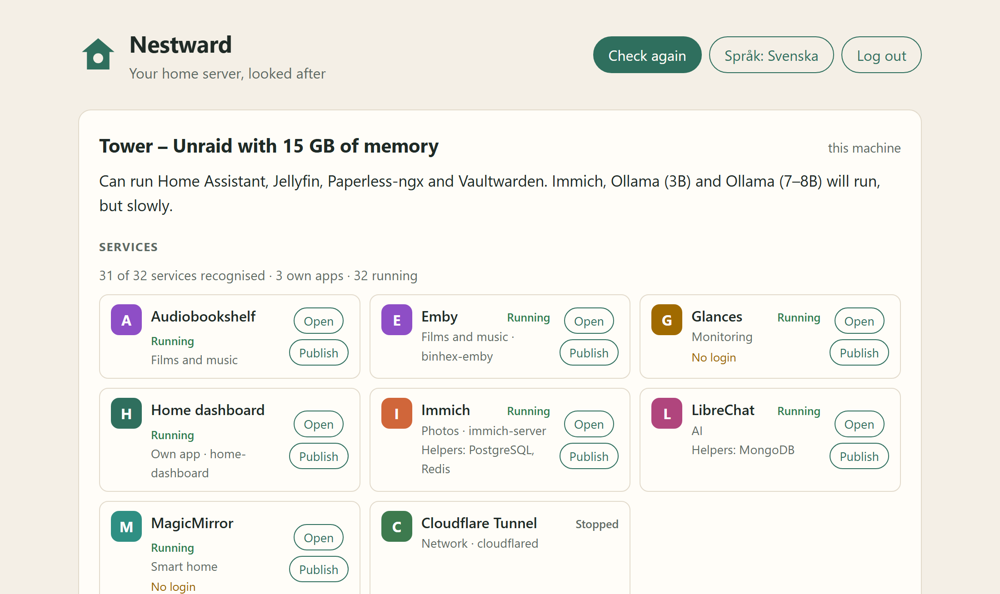
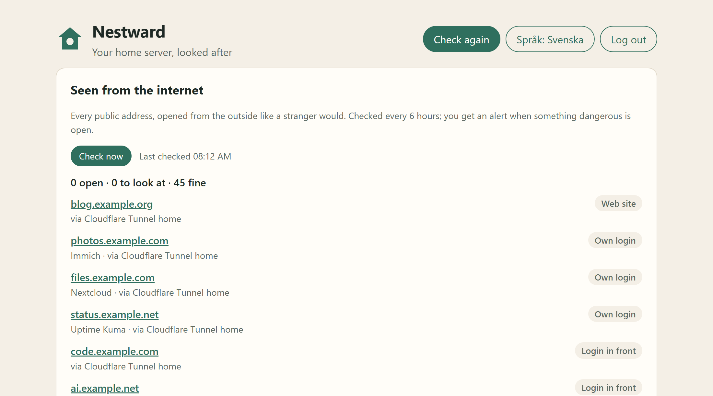

# Nestward

**Nestward** (Swedish: *Hemvakten*) is an ops layer for the home server you
already have. It runs on top of Unraid, Proxmox, TrueNAS, Synology, Home
Assistant OS, Raspberry Pi OS or plain Linux – it never replaces them.

Version 1 will: analyse the hardware, find the services already running,
watch them and alert your phone through ntfy, publish chosen services on
your own domain with one click, and give the home a health score.

> Status: **all five version-1 features are in** – hardware analysis,
> discovery, monitoring and alerts, publishing (Cloudflare and Tailscale)
> and the health score – plus login and encrypted agents. Early release:
> it runs every day on a real home setup, but expect rough edges.

## Screenshots

**Health of the home** – one number and a short list of what to fix.



**Services** – everything already running, recognised and linked.



**Seen from the internet** – every public address, checked from the outside.



## Install

One container on the machine you want to watch (amd64 or arm64):

```sh
docker run -d --name nestward --restart unless-stopped   -p 8470:8470 -p 8472:8472   -v nestward-data:/data   -v /:/host:ro   -v /var/run/docker.sock:/var/run/docker.sock:ro   --add-host=host.docker.internal:host-gateway   ghcr.io/wizz666/nestward:latest
```

Then:

1. Read the one-time setup code: `docker logs nestward`
2. Open `http://<server-ip>:8470`, create your account and scan the
   two-step code with an authenticator app.
3. Follow the health score: it tells you what to set up next (alerts,
   the outside watch, other machines).

Port 8472 is only needed when other machines report in (see
*Adding another machine*). Keep 8470 inside your home network or Tailscale –
do not forward it on your router.

**On a server with a public address (a VPS):** Docker opens published ports
past the firewall (ufw does not stop them). Bind them to one address instead,
for example `-p 127.0.0.1:8470:8470` and reach the page through an SSH tunnel
or Tailscale, or `-p <tailscale-ip>:8470:8470`.

Without Docker: download `nestward-linux-amd64` or `-arm64` from the
[latest release](https://github.com/wizz666/nestward/releases/latest),
make it executable and run `./nestward serve`.

Update: `docker pull ghcr.io/wizz666/nestward:latest`, then remove and start
the container again with the same command. Your data stays in the
`nestward-data` volume.

## What works now

- `nestward serve` – the core, with a web interface on `http://127.0.0.1:8470`
  (English and Swedish) and a JSON API.
- `nestward agent` – reports another machine's hardware to the core.
- `nestward report` – prints this machine's report in the terminal.
- Hardware analysis: processor type, cores and AVX2, memory, graphics card and
  video memory (Nvidia, AMD, Intel), disks (SSD, HDD, NVMe, memory card) and
  free space, virtualization support, and the system (Unraid, Proxmox,
  TrueNAS, Synology, HA OS, Pi OS, generic Linux).
- Discovery: lists every Docker container, recognises the app in it from
  `signatures/apps.yaml` (about 120 apps), links helpers such as databases to
  the app they serve, marks images you built yourself as your own apps, and
  finds the web page (Unraid's WebUI label, the published port, or the app's
  usual port). On a real Unraid server with 33 containers it recognised all 30 public images.
- Monitoring: every minute Nestward checks that each container runs and is
  healthy, that each web page answers, and that every agent machine keeps
  reporting. Two failed rounds in a row (about 2 minutes) send an alert to
  the phone through ntfy; a second message says when it works again. Problems
  on one machine are joined into one message. Containers that were already
  stopped when first seen never raise alarms.
- Outside watch: Nestward pings an address every minute (`heartbeat.url`).
  `nestward watchdog` on a VPS, or a service like healthchecks.io, raises the
  alarm when the pings stop – the one alert a home without power or internet
  cannot send itself.
- Login: one admin account with a password and a 6-digit code from an
  authenticator app. The first account can only be created with a one-time
  code printed in Nestward's log. `nestward reset-login` removes the login if
  the password or phone is lost.
- Publishing: choose a service, a name and a domain, click Publish. Nestward
  adds a route to an existing remote-managed Cloudflare Tunnel, a DNS record,
  and a Cloudflare Access login (code by e-mail) in front of every app without
  its own login. It never takes over an address that is already in use, undoes
  its steps if one fails, and every publication has an Undo button. Video apps
  (Plex, Jellyfin, Emby) need an extra confirmation because of Cloudflare's
  terms.
- Publishing in Tailscale: the service becomes its own device in your
  tailnet (built in with tsnet), reachable only from your own logged-in
  devices at `https://name.your-tailnet.ts.net` (or `http://name` without
  HTTPS certificates). No domain needed, nothing opened to the internet; the
  better path for films and music. Undo removes the device from the tailnet.
- Health score: one number from 0 to 100 for the home, with a plain list of
  what to do. Nestward only deducts for what it can see (alerts, outside
  watch, silent machines, services not working, full disks, low memory,
  published addresses that do not answer); most items have a button that
  opens the right setting or jumps to the problem.
- An app catalog (Home Assistant, Immich, Ollama 3B and 7–8B, Jellyfin,
  Paperless-ngx, Vaultwarden) and a plain-language answer per app:
  *runs well*, *runs slowly* or *cannot run*, with a suggestion. With several
  machines it suggests where an app would run better.

## Build it yourself

```sh
docker build -t nestward .
docker run --rm -p 127.0.0.1:8470:8470 -v nestward-data:/data -v /:/host:ro   -v /var/run/docker.sock:/var/run/docker.sock:ro nestward
```

**About the Docker socket.** Nestward only reads the container list (it sends
GET requests only), but Docker cannot limit what a socket user may do, so
`:ro` does not make it read-only. For least privilege, run a socket proxy that
only allows listing containers and point Nestward at it:

```sh
docker run -d --name nestward-socket-proxy -e CONTAINERS=1   -v /var/run/docker.sock:/var/run/docker.sock:ro tecnativa/docker-socket-proxy
docker run ... --link nestward-socket-proxy -e DOCKER_HOST=tcp://nestward-socket-proxy:2375 nestward
```

To check web pages on the same machine from inside the container, add
`--add-host=host.docker.internal:host-gateway` (or set `host.address`).

Without the socket Nestward still shows the hardware report and says it
cannot see Docker. `NESTWARD_DISCOVERY=off` turns discovery off.

List the services in the terminal, or read a saved list from another machine:

```sh
nestward discover
nestward discover --from containers.json   # output of GET /containers/json?all=1
```

Open <http://127.0.0.1:8470>. The `/:/host:ro` mount lets Nestward read the
host's system files (read-only) so it can tell which system it runs on.

Without a compiler on the server (lighter):

```sh
make cross
docker build -f Dockerfile.release -t nestward .
```

Print the report without the web interface:

```sh
docker run --rm -v /:/host:ro nestward report --lang sv
docker run --rm -v /:/host:ro nestward report --json
```

## Publishing through Cloudflare

Create an API token in the Cloudflare dashboard (My Profile → API Tokens →
Create Token → Custom) with only:

- Account · Cloudflare Tunnel · Edit
- Account · Access: Apps and Policies · Edit
- Zone · DNS · Edit and Zone · Zone · Read (only the domains you will use)

Paste it in the web page the first time you press Publish (it is stored
encrypted), or set it on the command line:

```sh
nestward config set cloudflare.token -      # reads the token from standard input
nestward config set publish.emails you@example.com
```

Nestward works with tunnels managed in Cloudflare ("remote-managed"); a
tunnel configured in a local `config.yml` cannot be changed through the API.
The target is the app's address on the home network as the machine running
`cloudflared` sees it, for example `http://192.168.1.10:8080`.

## Publishing in Tailscale

In the Tailscale admin page: Settings → Keys → Generate auth key, with
**Reusable** on and **Ephemeral** off. For https addresses also turn on
MagicDNS and HTTPS Certificates under DNS. Paste the key the first time you
choose "Only my own devices" when publishing, or:

```sh
nestward config set tailscale.authkey -
```

Each published service keeps its Tailscale identity in
`<data>/tailscale/<name>`, so it comes back after a restart. The target must
be reachable from Nestward itself (inside Docker: the machine's address on
the home network, not 127.0.0.1).

## Alerts to the phone

Install the ntfy app on the phone and subscribe to a topic. Then tell
Nestward where to send (inside Docker: `docker exec nestward /nestward config ...`):

```sh
nestward config set ntfy.url https://ntfy.sh        # or your own ntfy server
nestward config set ntfy.topic a-long-random-topic  # on ntfy.sh the topic is the password
nestward config set ntfy.token tk_...               # only if your server needs one
nestward config set alerts.lang sv
nestward test-alert
```

Secret settings are encrypted in the data folder (`secret.key`) and never
shown again. `nestward config list` shows what is set. The web page shows
where alerts go, has a test button and lists the latest changes.

### When the whole home goes down

Run the watchdog somewhere else, for example on a small VPS:

```sh
NESTWARD_WATCHDOG_TOKEN=$(openssl rand -hex 16) NTFY_URL=https://ntfy.sh NTFY_TOPIC=a-long-random-topic nestward watchdog --listen :8471 --name Home --timeout 3m --lang sv
```

and point the home's Nestward at it (put it behind HTTPS):

```sh
nestward config set heartbeat.url https://watchdog.example.com/ping/<token>
```

If no ping arrives for 3 minutes the watchdog sends "Home is not answering",
and "Home is back online" when the pings return. Any service that accepts a
regular GET (such as healthchecks.io) works the same way.

## Adding another machine

Other machines report through a small agent over an encrypted connection.
The core is its own certificate authority (`<data>/pki`), listens for agents
on port 8472 (`--agent-addr`), and gives every agent its own certificate:

1. In the web page, press **Add machine**. Nestward shows a command with a
   one-time code (30 minutes) and the core's fingerprint.
2. Run it on the other machine. The agent checks the fingerprint, so it only
   ever talks to your Nestward, and gets a certificate for its machine id.
3. After that it just runs `nestward agent` (or the container restarts) and
   reports every 30 seconds.

An agent cannot report as another machine, and **Remove** in the web page
revokes its certificate at once. The agent opens no ports: nothing can
connect to it or control it.

A removed agent says so once in its log and then stays quiet: it sends
nothing more and does not exit, so Docker does not restart it over and over.
To bring the machine back, press **Add machine** again and run the new
command; the old, used code does nothing.

With a shell on the core's machine you can skip the web page:
`nestward agent-code --core 192.168.1.10` prints the same commands.

### Proxmox hosts

Proxmox VE hosts usually have no Docker. Run the agent on the host itself
(as a systemd service, as root) and it lists the host's virtual machines and
LXC containers with Proxmox's own read-only `pvesh get /cluster/resources`
and the guest config files – no API token needed, and nothing is ever
started, stopped or changed. Each guest is shown with its cores, memory and
disk, watched like a container (an alert when a running guest stops), and
recognised by name where it can be (`haos16.3` → Home Assistant, `ollama`,
`nextcloudpi` …) so its web page is checked too. Addresses come from the
container, the VM's guest agent or a static `ip=` in the config.

pvesh takes 1–3 seconds a call on small machines, so the list is read at
most once a minute and addresses are looked up in the background every
ten minutes. `NESTWARD_PROXMOX=off` turns it off.

## API

| Path | What |
|---|---|
| `GET /api/v1/report?lang=sv` | analysis of the machine the core runs on |
| `GET /api/v1/machines?lang=en` | all known machines with analysis |
| `GET /api/v1/profiles` | the app catalog |
| `GET /api/v1/i18n?lang=sv` | interface texts |
| `POST /api/v1/agent/enroll`, `/report` | agent port only (TLS 8472; report needs the agent's certificate) |
| `GET /api/v1/health` | the health score |
| `GET /healthz` | status and version |

## Developing

Needs Go 1.27 or newer. No C compiler: SQLite uses a pure-Go driver.

```sh
make test     # go vet + go test
make build    # dist/nestward
make cross    # dist/nestward-linux-amd64 and -arm64
make docker
```

Layout:

- `cmd/nestward` – the single program
- `internal/hardware` – reads the hardware (all inputs injectable for tests)
- `internal/catalog` – loads and validates app profiles
- `internal/analysis` – compares hardware with profiles, writes the answers
- `internal/i18n/locales` – **all** texts, one JSON file per language
- `internal/server` – HTTP API and embedded web interface (`web/`)
- `internal/store` – SQLite
- `internal/agent` – the agent
- `internal/discovery` – Docker client (read only) and app recognition
- `internal/monitor` – checks and their state (up, down, stopped)
- `internal/alert`, `internal/notify` – alert texts, ntfy, heartbeat
- `internal/watchdog` – the outside watch
- `internal/config`, `internal/secrets` – settings, encrypted secrets
- `internal/auth` – admin account, argon2id passwords, TOTP, sessions
- `internal/cloudflare` – small Cloudflare API client (+ `cftest` fake)
- `internal/publish` – publish, undo and outside check (Cloudflare and Tailscale)
- `internal/tailnet` – one tsnet node per service published in Tailscale
- `cmd/fakecf` – fake Cloudflare API for trying publishing locally
- `profiles/` – app profiles, one YAML file per app
- `signatures/` – how apps are recognised in containers (MIT)

### Adding a language

Copy `internal/i18n/locales/en.json` to `<code>.json` and translate the
values. A test checks that every language has the same keys and placeholders.

### Adding an app profile

Add `profiles/<id>.yaml` (see the existing files). The id must match the file
name, and both English and Swedish texts are required. The numbers are
starting estimates and should be replaced by measurements.

## Licence

The program is licensed under the **GNU AGPL-3.0** (see `LICENSE`).
The app profiles in `profiles/` and the signatures in `signatures/` are
licensed under **MIT** (see the `LICENSE` file in each folder) so other
projects can reuse them.

### Adding an app to the recogniser

Add a line to `signatures/apps.yaml` with the image names, the usual web port
and whether the app has its own login. A test checks the file, and
`nestward discover --from` lets you try it on a saved container list.

---

## På svenska

**Installera:** kör kommandot under *Install* ovan på servern, läs
engångskoden med `docker logs nestward`, öppna `http://<serverns-ip>:8470`
och skapa ditt konto. Hälsopoängen visar sedan vad du bör ställa in härnäst.
På en VPS med publik adress: bind portarna till en adress, till exempel
`-p 127.0.0.1:8470:8470`, eftersom Docker går förbi brandväggen.

Hemvakten är ett program som körs ovanpå den hemmaserver du redan har. Det här
är första delmålet: programmet startar, visar ett webbgränssnitt på svenska
och engelska, och talar om vad maskinen klarar – *klarar*, *klarar långsamt*
eller *klarar inte* – för Home Assistant, Immich, Ollama, Jellyfin,
Paperless-ngx och Vaultwarden, med ett förslag när något inte räcker.
Den hittar också alla tjänster som redan körs i Docker, känner igen vilken app
det är och visar dem som en karta med länkar. Varje minut kontrolleras att
tjänsterna fungerar, och larm skickas till mobilen via ntfy om något slutar
fungera. En vakt utanför huset larmar om hela hemmet blir tyst.
Webbsidan kräver inloggning med lösenord och tvåstegskod, och tjänster kan
publiceras på den egna domänen med ett klick, med inloggning framför och en
ångra-knapp.
